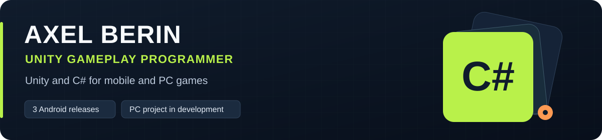

**I build gameplay systems in Unity and C# for mobile and PC games.**

I'm a game developer based in Buenos Aires, Argentina, with professional experience since 2024. I'm the founder and Lead Unity Developer at ABK Games, with three Android releases and a first-person horror game in development.

**Open to full-time Unity Developer and Gameplay Programmer roles.**  
Buenos Aires, Argentina · Spanish · English B2

[Portfolio](https://www.weareabk.com/games) · [LinkedIn](https://www.linkedin.com/in/axel-berin-190388242/) · [Email](mailto:axel.berin.2000@gmail.com) · [itch.io](https://axelberin.itch.io/)

[Projects](#selected-projects) · [Selected systems](#selected-systems) · [Technical skills](#technical-skills) · [Background](#background)

## Selected projects

### Magic Is Dead

**PC · Unity HDRP · In development**  
First-person psychological horror with exploration, puzzles and magic. A demo was showcased at EVA Play 2026.

My work includes:

- Bootstrap and service registration, game-state flow, inventory and object inspection.
- Save/load with multiple slots and checkpoints, persistent puzzle and world state, and additive room loading.
- Door interactions with hand IK, graphics/settings UI, and Wwise integration for pause/resume and environmental reverb.

[View on Steam](https://store.steampowered.com/app/5114760/Magic_is_Dead/) · [Project overview](https://www.weareabk.com/proyectos/magic-is-dead)

### Published Android games

| Multiverse Tap Ball | Definitive Impostor | Slide Draw |
| :---: | :---: | :---: |
|  |  |  |
| **Published 2025** | **Published 2026** | **Published 2025** |
| Gameplay modes and a skin shop. Unity LevelPlay and IAP integration, Firebase Authentication and Cloud Firestore. | Event-driven round flow, weighted role selection and category-based words. Versioned JSON settings with backup recovery. | Obstacle spawning with object pooling, prewarming and configurable difficulty profiles. Mobile controls and UI. |
| [Google Play](https://play.google.com/store/apps/details?id=com.ABKGamesStudio) | [Google Play](https://play.google.com/store/apps/details?id=com.abkgames.definitiveimpostor) | [Google Play](https://play.google.com/store/apps/details?id=com.abkgames.slideball) |

Slide Draw was previously titled Slide Small Ball.

## Selected systems

Examples of systems I've implemented across my Unity projects:

| System | Implementation focus |
| :--- | :--- |
| **Object pooling** | Prefab pools, prewarming and reuse of obstacle instances. |
| **Difficulty and spawning** | Configurable difficulty stages, spawn timing and obstacle lifecycle. |
| **Event-driven game flow** | Round and player state, role-reveal events and weighted impostor assignment. |
| **Local persistence** | Versioned JSON settings, backup recovery and change detection. |

## Technical skills

| Area | Experience |
| :--- | :--- |
| **Programming** | C#, OOP, SOLID, event-driven systems, MVC, service registration and object pooling |
| **Gameplay systems** | UI, inventory, object inspection, save/load, checkpoints and interaction |
| **Unity** | 2D/3D, HDRP, New Input System, TextMeshPro, Addressables, additive scene loading and inverse kinematics |
| **Mobile and services** | Android releases, iOS builds, Unity IAP, Unity LevelPlay, Firebase Authentication and Cloud Firestore |
| **Audio and performance** | Wwise integration, Unity Profiler, performance profiling and mobile optimization |
| **Workflow** | Git, Git LFS, Jira, ClickUp and collaboration across programming, design, art and audio |

Additional familiarity: Unreal Engine Blueprints.

## Background

- **ABK Games — Founder and Lead Unity Developer** · Jan 2025–present  
  Gameplay implementation, technical architecture, team coordination, mobile releases and post-launch support.
- **Una Partida Más — Unity Game Developer** · Mar–Nov 2024  
  Designed and implemented an MVC-based UI system, integrated gameplay/data, and maintained existing systems.
- **Superprof — Unity and C# Programming Tutor** · Nov 2024–present  
  Practical teaching of programming, OOP, Unity, debugging and problem solving.
- **Da Vinci — Game Development and Programming** · Aug 2020–2024  
  Completed.

## Let's talk

I'm interested in full-time opportunities where I can contribute to gameplay, UI and game systems with Unity and C#.

[Contact me by email](mailto:axel.berin.2000@gmail.com) · [Connect on LinkedIn](https://www.linkedin.com/in/axel-berin-190388242/)

